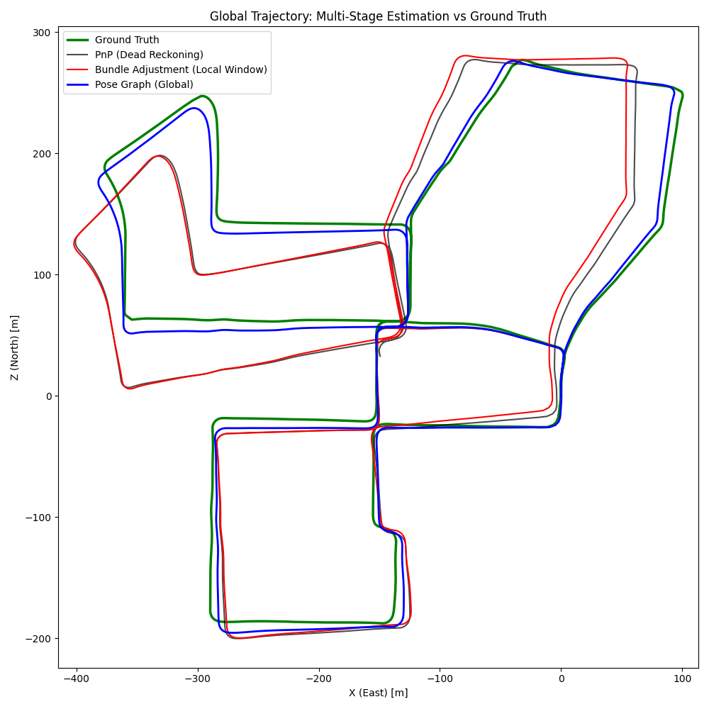
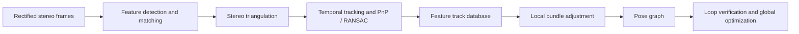
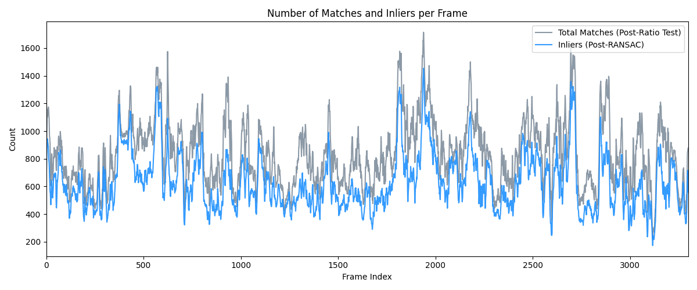
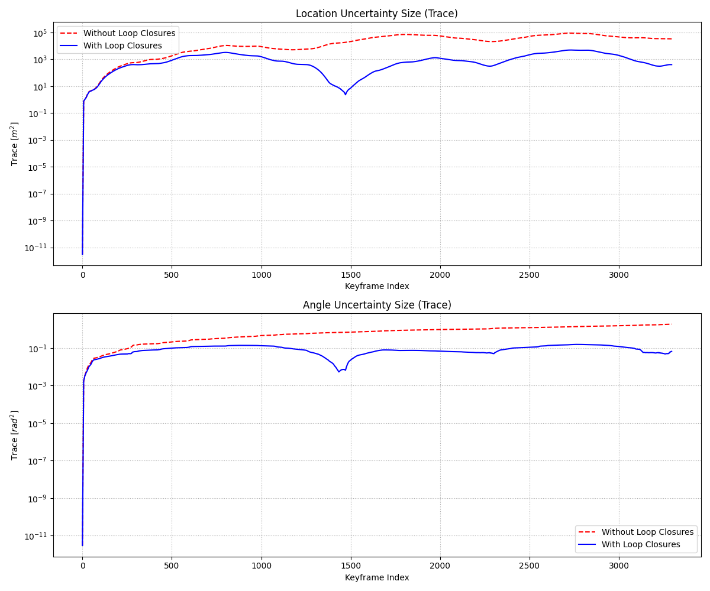
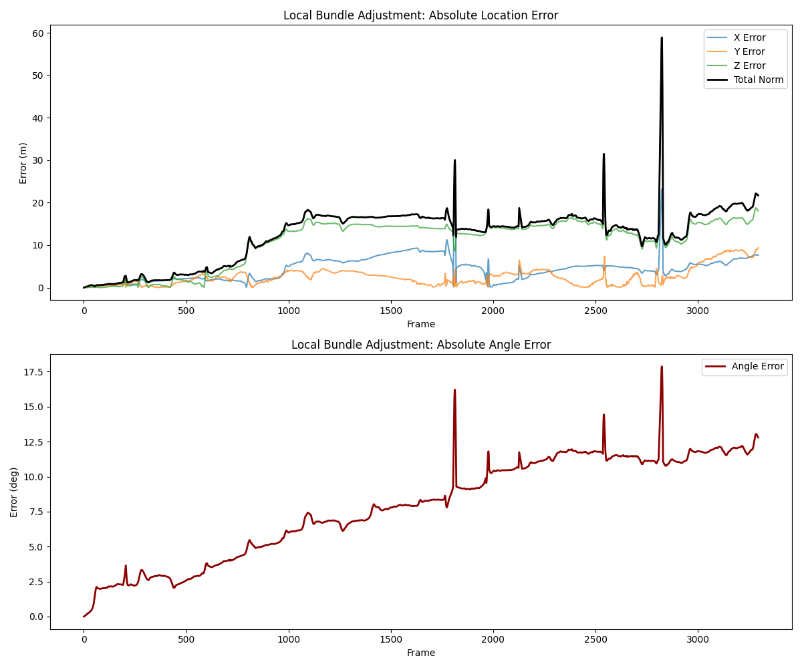

# 3D Computer Vision · Stereo Visual SLAM

Stereo visual odometry and SLAM in Python, built around feature tracking, multi-view geometry, local bundle adjustment, pose-graph optimization, and loop closure. Experiments use **KITTI Odometry sequence 00** to evaluate camera trajectories, reprojection errors, feature consistency, and pose uncertainty.

**Stack:** Python · OpenCV · NumPy · GTSAM · Matplotlib  
**Areas:** Visual SLAM, geometric computer vision, nonlinear optimization, graph-based inference



*Estimated camera trajectories compared with KITTI reference poses.*

## Pipeline



The system progresses from frame-to-frame pose estimation to globally consistent trajectory refinement. Loop candidates are filtered using geometric and uncertainty-based checks before additional constraints enter the pose graph.

## Implementation

| Stage | Methods | Code |
|---|---|---|
| Stereo data and calibration | KITTI stereo image loading, projection matrices, reference poses | [`dataset_utils.py`](code/dataset_utils.py) |
| Feature association | AKAZE, stereo and temporal correspondence checks | [`feature_tracking.py`](code/feature_tracking.py) |
| Geometry and pose | Triangulation, reprojection error, PnP/RANSAC | [`geometry.py`](code/geometry.py) |
| Track management | Indexed observations, track histories, serialization | [`tracking_database.py`](code/tracking_database.py) |
| Local optimization | Keyframes, GTSAM bundle adjustment | [`bundle_adjustment.py`](code/bundle_adjustment.py) |
| Global optimization | Relative pose factors, pose-graph updates | [`pose_graph.py`](code/pose_graph.py) |
| Loop closure | Candidate filtering, Mahalanobis checks, verification | [`loop_closure.py`](code/loop_closure.py) |
| Measurement and plotting | Trajectory error, tracking statistics, uncertainty analysis | [`performance_analysis.py`](code/performance_analysis.py), [`visualization.py`](code/visualization.py) |

Experiment drivers [`ex1.py`–`ex7.py`](code/) cover the stages in sequence, from pairwise geometry and feature association to loop-closure experiments. They are **not** a single command-line pipeline; later stages depend on intermediates produced earlier.

## Evaluation on KITTI 00

The final evaluation reports the following for an experiment covering **3,300 frames**:

| Metric | Value |
|---|---:|
| Feature tracks recorded | 438,490 |
| Mean track length | 4.74 frames |
| Mean feature links per frame | 629.69 |

| Feature tracking and inliers | Pose uncertainty |
|:---:|:---:|
|  |  |



The results compare incremental PnP estimates, bundle-adjusted poses, and pose graphs with/without loop closure. Detailed methodology, plots, and interpretation are in the [technical report](docs/reports/final-project/final_project_report.pdf). Figures describe the original experimental configuration and are not a KITTI leaderboard submission.

## Setup and execution

**Dataset:** [KITTI Odometry](https://www.cvlibs.net/datasets/kitti/eval_odometry.php), grayscale stereo sequence `00`, camera calibration, and reference poses. Dataset files are not included. The exact layout is documented in [Dataset setup](docs/dataset-setup.md).

**Python dependencies:** OpenCV, NumPy, GTSAM, and Matplotlib (see [`requirements.txt`](requirements.txt)). A compatible Python/GTSAM combination is required.

```powershell
python -m venv .venv
.\.venv\Scripts\Activate.ps1
python -m pip install -r requirements.txt
cd code
python ex1.py
```

Run from `code/`, because the implementation uses relative paths into `../dataset/`. The tracking stage (`ex4.py`) generates a serialized feature database required by downstream stages. See the exercise scripts and the [dataset setup guide](docs/dataset-setup.md) for data requirements.

The complete dataset-dependent workflow has not been re-run with a clean installation; dependency versions are not pinned to a tested environment.

## Technical skills

Stereo geometry and calibration · robust model fitting · feature tracking · nonlinear least squares · factor graphs · uncertainty modeling · loop-closure verification · trajectory evaluation · scientific visualization.

## Documentation

Individual experiment reports are available under [`docs/reports/`](docs/reports/), alongside the [final analysis](docs/reports/final-project/final_project_report.pdf). The datasets and large serialized tracking artifacts are intentionally external to the repository.
